---

## Featured

### [Sports Conflict Tracker](https://github.com/Slayniaccc/sports-conflict-tracker)
*Java 21 · Spring Boot 3.3 · Postgres 16 · Flyway · TypeScript · Docker · GitHub Actions*

Detects fixture clashes across your followed teams and scores which one to watch, with reasoning. NBA, NFL, MLB and EPL data from BALLDONTLIE and Football-Data.org.

A pure-Java rule engine scores conflicts on rivalry, playoff implications, form and home advantage, layered with Spring rather than through it. JWT auth, Flyway migrations, paginated provider syncs. Frontend in progress.

### [Medication Management Dashboard](https://github.com/Slayniaccc/medication-management-dashboard)
*React 19 · TypeScript · Tailwind v4 · IndexedDB · Vitest · GitHub Actions*

An accessibility-first tool for carers managing someone else's medication, built around a carer supporting a person with vision, mobility and cognitive conditions. Started as a CodeForAll 2026 hackathon entry, rebuilt solo.

Doses are modelled as events in time rather than a status flag, so schedules can change without rewriting history. Local-first by design: no account needed, nothing leaves the device. Tested with a real screen reader, not just an automated audit.

### [Eyes On The Sky](https://github.com/Slayniaccc/EyesOnTheSky) · [play](https://slayniaccc.github.io/EyesOnTheSky/)
*JavaScript · Phaser 3 · PWA*

Built during my internship at Hillingdon Council. An educational game putting Year 6 pupils inside the Dowding System during the Battle of Britain, tablet-first for classroom use.

---

## Also

| Project | What it does | Built with |
|---|---|---|
| **[Mastermind](https://github.com/Slayniaccc/mastermind)** | Colour-guessing game with hints, scoring and file logging | Java · Raspberry Pi |
| **[Simon Swift](https://github.com/Slayniaccc/simonswift)** | Memory game driving LEDs, buttons and motion sensors | Java · Raspberry Pi |
| **[Repo Card Generator](https://github.com/Slayniaccc/github-repo-card-generator)** | Customisable GitHub repo cards on the GitHub API | JS · HTML · CSS |

---

## Leadership

**Secretary, [Brunel Cyber Security Society](https://brunelcybersec.github.io/brunel-cyber-society/)** · 2026/27  
Run a student-led community around security workshops and CTFs. Comms, event planning and digital presence. [GitHub](https://github.com/brunelcybersec)

**PAL Leader, Brunel University London** · 2026/27  
Weekly peer-assisted learning sessions and study skills mentoring for first-year students.

---

## Studio

**Co-Founder, [Strayline Games](https://www.instagram.com/straylinegames/)** · 2026 to present  
Indie studio of three building **CRIMSONCARVE**, a rogue-like. Core mechanics and event graphs in Unreal Blueprints, binary asset versioning with Perforce. [TikTok](https://www.tiktok.com/@straylinegames)

---

